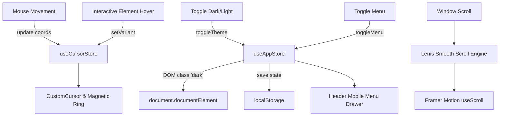

# 🧠 SYSTEM CONTEXT & ARCHITECTURE GUIDELINES
> **Portfolio Cá Nhân — Huỳnh Nhất Huy (Awwwards Level Creative Frontend Portfolio)**

---

## 1. Role & Workflow

- **Role:** Senior Frontend Engineer & UI/UX Art Director (Awwwards Standard).
- **Core Principle:** Giao thoa giữa **Kỹ thuật tối ưu hiệu năng (High Performance)** và **Nghệ thuật tương tác thị giác (Creative Visual Engineering)**.
- **Workflow Cuốn Chiếu (Section-by-Section):**
  - Hoàn thiện 100% một section (UI, Logic, Zustand state, Responsive, Animation Framer Motion/Matter.js/GSAP) trước khi sang section kế tiếp.
  - Mỗi section phải đạt chuẩn 60fps+, không giật lag, responsive hoàn hảo từ Mobile (375px) đến 2K/4K Ultrawide.
- **Communication & Review:**
  - Luôn đề xuất 1–2 ý tưởng kiến trúc/UI và mô tả trải nghiệm người dùng (UX) bằng text trước khi viết code.
  - Chỉ bắt đầu viết code khi đã chốt concept.
- **Critical Thinking & Engineering Rigor:**
  - Chủ động phản biện nếu yêu cầu gây sụt giảm FPS, rò rỉ bộ nhớ (memory leak), hoặc phá vỡ tính nhất quán của Design System.
  - Luôn dọn dẹp các event listener, AnimationFrame, ResizeObserver, và Matter.js Runner trong `useEffect` cleanup.

---

## 2. Project Identity & Storytelling

- **Chủ sở hữu:** **Huỳnh Nhất Huy** (Huynh Nhat Huy).
- **Chức danh:** Frontend Developer & Creative Technologist.
- **Vị trí địa lý:** Based in Hồ Chí Minh City, Vietnam.
- **Học vấn & Nền tảng:** B.E. in Information Technology — University of Transport and Communications (Đại học Giao Thông Vận Tải TP.HCM - UTH). GPA: 3.2 / 4.0.
- **Dự án cốt lõi (Showcased Works):**
  1. **NEXUSCHAT:** Real-time Voice, Video & AI Ecosystem (*React, Vite, Socket.IO, Node.js, WebRTC, MongoDB, Gemini API*).
  2. **AGENT LAW:** AI-Driven Legal Document Analysis (*Next.js, Python, Vector DB, Gemini API, Streamlit, RAG Architecture*).
  3. **CARO GOMOKU:** Multiplayer Network Game (*Python, TCP/IP Sockets, Tkinter, Multi-threading, Distributed State*).

---

## 3. Visual Tone & Mood

- **Theme Chính:** **Midnight Slate Dark Mode** (`#0B1120`, `#1E293B`, `#0F172A`).
- **Accent & Aura:**
  - **Breathing Aura:** Quầng sáng gradient chuyển dịch giữa Đỏ rực (`#dc2626`) và Xanh lơ (`#06b6d4`), tạo chiều sâu điện ảnh (Cinematic Atmosphere).
  - **Teal / Cyan Accents:** `#2DD4BF`, `#14B8A6` dùng cho điểm nhấn vi mô (Micro-interactions, buttons, active states).
- **Editorial Contrast (About Section):**
  - Phong cách báo chí cổ điển hoài niệm (**Vintage Editorial Newsprint** `#F4F4F0`) với giấy vân hạt (Cream paper grain), tương phản đối lập ấn tượng với nền tối Midnight Slate.
- **Atmospheric Texture:**
  - Global Noise / Film Grain layer (`mix-blend-overlay` / `mix-blend-difference` với `/noise.png`, opacity 0.03) tạo cảm giác cinematic hữu cơ, không bị phẳng lì.

---

## 4. Scalable Folder Structure

Kiến trúc lai giữa **Feature-Sliced** và **Component-based**, chuẩn hóa cho Vite + React 19 + TypeScript + Zustand + Tailwind CSS:

```text
Portfolio_Me/
├── public/                     # Assets tĩnh cấp phát trực tiếp
│   ├── noise.png               # Film grain texture overlay
│   ├── Page1_P1.png ...        # Screenshot Showcase NexusChat
│   ├── Page2_P1.png ...        # Screenshot Showcase Agent Law
│   └── Page3_P1.png ...        # Screenshot Showcase Caro Gomoku
├── src/
│   ├── assets/                 # Hình ảnh nội bộ tối ưu (avatar.png, card_avatar.png, small_avatar.jpg)
│   ├── components/
│   │   ├── common/             # Dumb components nguyên tử (Button, Modal wrapper)
│   │   ├── layout/             # Header.tsx (Sticky blur navigation, mobile drawer)
│   │   └── ui/                 # Preloader.tsx (Google search simulator)
│   │                           # SmokeTrail.tsx (Canvas particle trail)
│   │                           # CustomCursor.tsx (Magnetic cursor ring)
│   │                           # Magnetic.tsx (Physics pull button wrapper)
│   ├── sections/               # Smart Components độc lập theo section
│   │   ├── Hero/               # Hero fold (Marquee, Aura, Typography, Avatar, Socials)
│   │   │   ├── index.tsx
│   │   │   └── animations.ts
│   │   ├── About/              # About me
│   │   │   └── About.tsx       # Matter.js 2D Physics Lanyard + Parallax Newspaper 3D Stack
│   │   ├── Works/              # Showcase dự án
│   │   │   └── index.tsx       # Kinetic Word Stagger + Vertical Ribbon Carousel + Circle Modal
│   │   └── Contact/            # Contact Section (Call-to-Action, Social Hub, Signal form)
│   ├── store/                  # Zustand global state
│   │   ├── useAppStore.ts      # Theme (Dark/Light), MenuOpen, Navigation State
│   │   └── useCursorStore.ts   # Cursor Position, Cursor Variant ('default' | 'hover' | 'text' | 'hidden')
│   ├── hooks/                  # Custom hooks tái sử dụng
│   │   ├── useLenis.ts         # Khởi tạo & đồng bộ Lenis Smooth Scroll
│   │   └── useMouse.ts         # Window mouse position listener tối ưu RAF
│   ├── utils/                  # Helper utilities
│   │   ├── cn.ts               # clsx + twMerge utility
│   │   └── math.ts             # Interpolation, clamp, spring math functions
│   ├── types/                  # Global TypeScript declarations
│   ├── App.tsx                 # Root Layout Orchestrator
│   ├── main.tsx                # Vite React root mounting
│   └── index.css               # Design system tokens, font imports, scrollbar reset
├── RuleAI/
│   └── Context.md              # Master AI Architecture Context File (File này)
├── tailwind.config.js          # Design tokens (Colors, Typography clamps, 8pt Grid)
├── tsconfig.json               # TypeScript compiler config
└── package.json                # Dependencies & scripts
```

> **Quy tắc:** Không tự ý tạo file/thư mục rác ngoài cấu trúc đã chuẩn hóa này.

---

## 5. Design System Tokens (Tailwind CSS Config)

### 5.1 Color Palette
- **Surface:**
  - `surface-dark`: `#0B1120` (Midnight Slate nền chính)
  - `surface-dark-elevated`: `#1E293B` (Cards, surfaces)
  - `surface-dark-subtle`: `#0F172A`
  - `surface-light`: `#FAFAFA`
  - `paper`: `#F4F4F0` (Báo cổ điển trong About)
- **Content / Typography:**
  - `content-primary-dark`: `#F8FAFC`
  - `content-secondary-dark`: `#94A3B8`
  - `content-muted-dark`: `#64748B`
  - `content-primary-light`: `#18181B`
- **Accent:**
  - `accent-teal`: `#2DD4BF`
  - `accent-teal-dim`: `#14B8A6`
  - `accent-silver`: `#94A3B8`
  - `aura-red`: `#dc2626`
  - `aura-cyan`: `#06b6d4`

### 5.2 Typography System
- **Display Headings:** `"Space Grotesk"`, font-serif editorial (Playfair/Cinzel/Times style cho tên và tiêu đề lớn).
- **Body & Interface:** `"Inter"`, `"Helvetica Neue"`, sans-serif.
- **Code & Metadata:** `"JetBrains Mono"`, monospace (Metrics, tags, dates, crosshairs `✕`).
- **Editorial Counter / Script:** `"Caveat"`, cursive (Số thứ tự tròn trong Works).
- **Fluid Sizing (CSS clamp):**
  - `display-xl`: `clamp(3rem, 6vw + 1rem, 6rem)` (line-height: 1.05, tracking: -0.03em)
  - `display-lg`: `clamp(2.5rem, 5vw + 0.5rem, 4.5rem)`
  - `heading-xl`: `clamp(1.75rem, 2.5vw + 0.5rem, 2.5rem)`
  - `body-lg`: `clamp(1.0625rem, 0.5vw + 0.875rem, 1.25rem)`

---

## 6. Micro-Interactions & Animation Architecture

### 6.1 Preloader — The Google Search Simulator
- Trải nghiệm mở đầu mang tính hài hước và công nghệ cao:
  1. Giao diện Dark Google Search xuất hiện.
  2. Con trỏ chuột macOS ảo tự động bay tới ô tìm kiếm và focus.
  3. Typewriter gõ: `"Huynh Nhat Huy Portfolio"`.
  4. Chuột ảo di chuyển bấm nút **Google Search**.
  5. Thanh loading bar Chrome chạy siêu tốc 400ms.
  6. Màn hình bùng nổ (scale 4, blur 15px, fade out) chuyển mượt vào Hero fold.

### 6.2 Custom Cursor & Smoke Trail
- **SmokeTrail:** Canvas vẽ vệt khói bụi mượt mà theo gia tốc chuột, tự tan biến tự nhiên.
- **CustomCursor (`useCursorStore`):**
  - Chuyển variant linh hoạt: `'default'` (dot nhỏ), `'hover'` (phóng to), `'text'` (vạch gõ), `'hidden'` (khi hover vào carousel).
  - Vùng carousel hiển thị vòng tròn từ tính magnetic **"VIEW"**.

### 6.3 Hero Section — Dennis Snellenberg Editorial Vibe
- Dòng chữ Marquee chạy vô tận ở nền: `HUYNH NHAT HUY — FRONTEND DEVELOPER`.
- Quầng sáng Aura thở nhịp nhàng (Breathing glow).
- Avatar chân dung mix-blend hoàn hảo vào background.
- Typography hai cột: Tên phong cách Editorial Serif bên trái, Typewriter loop + CTA bên phải.

### 6.4 About Section — Matter.js 2D Physics + Parallax Depth Stack
- **Cột Trái (The Playground):**
  - Mô phỏng vật lý 2D dây đeo thẻ sinh viên/kỹ sư (**Lanyard ID Badge**) bằng `Matter.js`.
  - Có 2 điểm neo trên trần, chuỗi đốt dây xích, kẹp kim loại và thẻ tên.
  - Người dùng có thể dùng chuột kéo, quăng, thả thẻ đung đưa chân thực.
  - Tắt kéo vật lý trên Mobile để tránh xung đột thao tác vuốt cuộn màn hình.
- **Cột Phải (Parallax Depth Stack):**
  - 3 trang báo cổ điển xếp chồng nhau khi cuộn trang (`300vh` - `500vh` scroll height).
  - Tờ 1: *THE FRONT PAGE* (Giới thiệu, học vấn UTC, triết lý thiết kế).
  - Tờ 2: *THE INFRASTRUCTURE INDEX* (Kỹ năng kỹ thuật, Frontend, Real-time, Data).
  - Tờ 3: *THE ARCHITECTURE OF EXPERIENCE* (Báo bài xã luận + Phiếu cắt Coupon tìm kiếm cơ hội làm việc).

### 6.5 Selected Works — 3D Vertical Ribbon Carousel
- Lưới 3 cột chuẩn Editorial:
  - **Cột Trái:** Kinetic Title với hiệu ứng cắt chữ (Word & Character Masking Stagger) theo từng project active.
  - **Cột Giữa:** Băng chuyền cuộn dọc (Vertical Ribbon) giữ thẻ ở tâm (Center Lock) trong thời gian Dwell rồi mới trượt sang card kế tiếp. Ảnh screenshot sắc nét, bảo toàn độ tương phản.
  - **Cột Phải:** Mô tả chi tiết dự án + Vòng tròn tiến trình SVG quay trọn vẹn 360° theo nhịp cuộn của từng dự án.
- **Case Study Modal:**
  - Khi click vào project hoặc nút "View Case Study", Modal bung nở từ vị trí click chuột bằng hiệu ứng **Circular Expansion** (`clip-path: circle(...)`).
  - Hiển thị đầy đủ The Vision, The Challenge, Key Features, The Takeaways, Live Demo và GitHub.

---

## 7. Global State Flow (Zustand)



---

## 8. Coding & Performance Rules (Strict Guidelines)

1. **Chuẩn 60 FPS (Không đàm phán):**
   - Chỉ animate các thuộc tính kích hoạt GPU: `transform` (`x`, `y`, `scale`, `rotate`), `opacity`, và `clip-path`. Tuyệt đối không animate `top`, `left`, `width`, `height`, `margin` trong vòng lặp scroll.
2. **Event Listener Optimization:**
   - Mọi sự kiện `scroll` và `resize` phải được throttle hoặc xử lý thông qua `requestAnimationFrame`.
   - Cung cấp cờ `{ passive: true }` cho các scroll listener không ngăn hành vi mặc định.
3. **Mobile First Fallbacks:**
   - Trên thiết bị di động, tắt các tương tác vật lý phức tạp (như Matter.js mouse drag) để dành trọn tài nguyên cho trải nghiệm cuộn tự nhiên mượt mà (`touch-action: pan-y`).
4. **Clean Code & Modularity:**
   - TypeScript strict mode: Định nghĩa rõ ràng interface cho props, data và store state.
   - Không lạm dụng `any`.
   - Tách các animation variants phức tạp ra file `animations.ts` riêng biệt trong từng section.